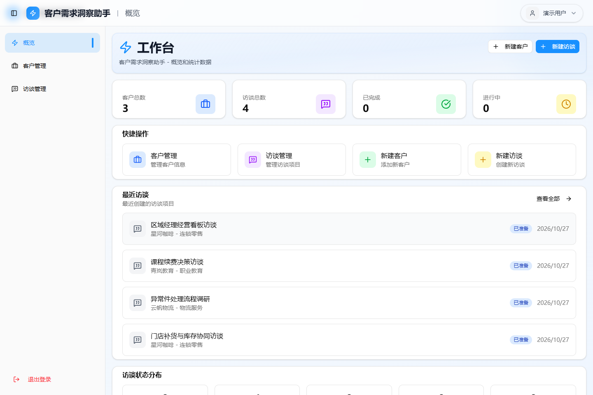
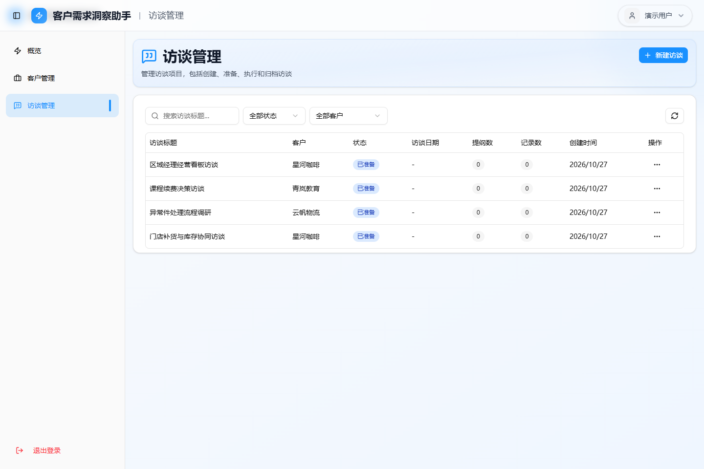
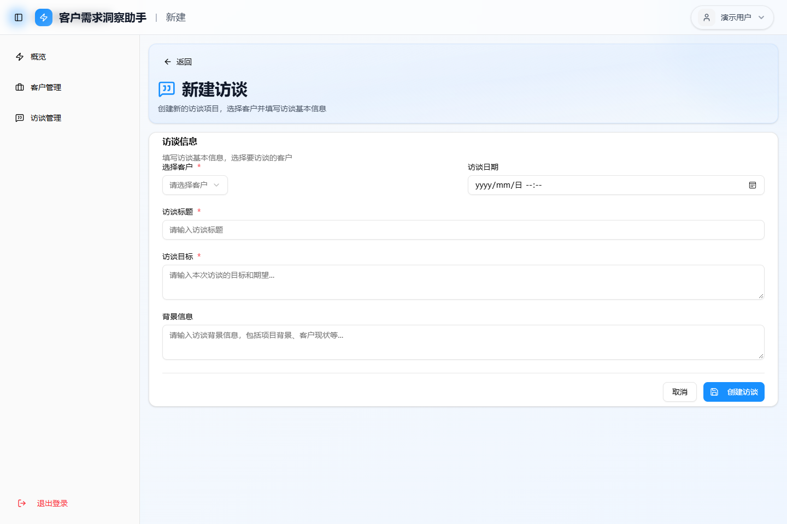
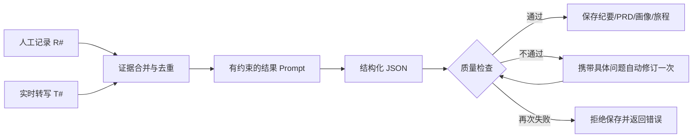
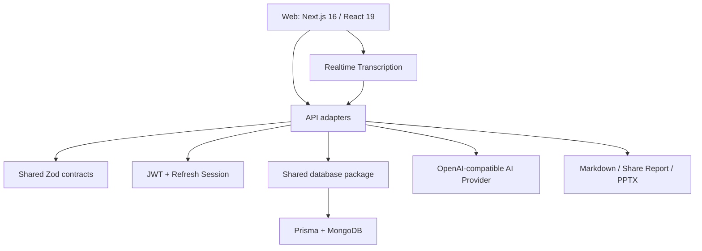

<div align="center">

# TalkAgent

### 有证据、可复核的开源 AI 客户访谈工作台

从访谈准备、实时记录到纪要、PRD、用户画像和旅程图，让每一条 AI 结论都能回到访谈原文。


</div>



> 截图中的公司、人物和业务数据均为虚构内容。

## TalkAgent 是什么？

TalkAgent 面向产品经理、用户研究员、售前、客户成功和创业团队，帮助他们把分散的客户访谈过程变成一条可追踪的研究链路：

```text
客户信息 → 访谈目标 → 访谈提纲 → 实时记录 → 证据整理
        → 纪要 / 风险 → PRD → 用户画像 → 用户旅程图
```

普通 AI 总结容易写出“看起来合理、但原文没有”的内容。TalkAgent 会为人工记录和实时转写分配 `[R#]`、`[T#]` 证据编号，要求模型引用证据，并将没有依据的信息标记为 `[待确认]`。结构或证据覆盖不达标时，系统会自动要求模型修订一次；再次失败则不保存结果。

## 为什么做这个项目？

客户访谈后的常见问题并不是“没有文字”，而是：

- 录音、笔记、群聊和业务背景散落在不同位置；
- 事实、推断和建议混在一起，团队难以复核；
- 纪要写完了，却无法继续转成需求、验收标准和行动项；
- AI 会补写受访者没有说过的人口属性、动机或业务数字；
- 下一位接手的人不知道某个结论来自哪段原话。

TalkAgent 的核心目标不是把结果写得更“漂亮”，而是让结果**可引用、可确认、可行动**。

## 核心能力

| 能力 | 说明 |
| --- | --- |
| 客户与访谈管理 | 管理客户、访谈目标、背景、日期和访谈状态 |
| 访谈提纲 | 创建和排序问题，支持 AI 辅助生成与缺口分析 |
| 实时记录 | 保存人工笔记和实时转写，支持高亮、类型和说话人信息 |
| 证据化纪要 | 输出总结、关键事实、痛点、需求、风险与下一步，并引用证据 |
| PRD 初稿 | 生成需求编号、证据、置信度、验收标准、非目标和未知项 |
| 用户画像 | 只使用访谈中确认的特征和原话，避免虚构人口属性 |
| 用户旅程图 | 根据真实行为链路整理阶段、行为、痛点和机会点 |
| 分享与导出 | 分享研究报告，下载 Markdown，并提供 PPTX 相关能力 |
| 安全基础 | JWT、刷新令牌轮换、HttpOnly Cookie、资源所有权和速率限制 |

## 实际页面

| 访谈管理 | 新建访谈 |
| --- | --- |
|  |  |

## 完整脱敏案例

仓库内提供了一套完全虚构的访谈输入和预期输出，可以直接判断这个项目生成的内容是否符合你的团队要求：

| 内容 | 你会看到什么 |
| --- | --- |
| [原始访谈与证据](./docs/demo/01-interview-evidence.md) | 13 条访谈记录、证据编号和明确缺失的信息 |
| [访谈纪要](./docs/demo/02-summary.md) | 关键事实、痛点、需求、风险、成功指标和下一步 |
| [PRD 初稿](./docs/demo/03-prd.md) | MVP、需求编号、证据、置信度、验收标准和非目标 |
| [画像与旅程图](./docs/demo/04-persona-journey.md) | 不虚构人口属性的画像和有证据的用户旅程 |

案例中的引用方式：

```markdown
- 销售与库存数据每周约有两次不一致。[R3]
- `[待确认]` “附近门店”的距离或组织范围定义。[R7]
```

完整说明见 [演示案例索引](./docs/demo/README.md)。

## 生成链路



质量检查会关注：

- 事实、痛点、需求和风险的证据覆盖率；
- PRD 是否包含验收标准、非目标和未知项；
- 画像是否包含可追溯原话；
- 旅程是否具备足够阶段并引用访谈证据；
- 输出是否满足 Zod 结构约束。

## 技术架构



主要技术：Next.js 16、React 19、TypeScript、MongoDB、Prisma、Zod、Zustand、Tailwind CSS、Radix UI、Playwright。

项目正在采用渐进式 Monorepo 迁移：现有根目录 Next.js 应用仍承担 Web 和兼容 API，`apps/api` 是独立后端进程，`packages/contracts` 与 `packages/database` 分别定义共享接口协议和唯一数据库入口。接口会按模块迁移，避免一次性重写破坏现有功能。详细边界和迁移规则见 [架构文档](./docs/architecture/README.md)。

## 五分钟本地体验

无需先注册 MongoDB Atlas。隔离预览会自动启动临时 MongoDB，并在终端显示演示账号：

```bash
npm install
npm run build
npm run preview:local
```

打开 `http://127.0.0.1:3000/login`。退出预览进程后，临时数据会被删除。为了避免误调用付费服务，隔离预览默认关闭真实 AI 调用。

## 正式开发环境

### 环境要求

- Node.js 20 或更高版本
- npm 10 或更高版本
- MongoDB 6 或更高版本
- 使用事务的完整流程需要 MongoDB 副本集或 MongoDB Atlas

### 安装

```bash
npm install
Copy-Item .env.example .env.local   # Windows PowerShell
# cp .env.example .env.local        # macOS / Linux
npm run db:generate
npm run dev
```

然后打开 `http://localhost:3000`。

### 最小环境变量

```dotenv
DATABASE_URL="mongodb://localhost:27017/talkagent"
PROJECT_TABLE_PREFIX="talkagent"
JWT_SECRET="使用密码管理器生成的至少32字节随机值"
REFRESH_SECRET="另一组至少32字节随机值"
VERIFICATION_CODE_SECRET="第三组至少32字节随机值"
```

三个 Secret 必须彼此不同。可以使用密码管理器，或分别执行三次：

```bash
node -e "console.log(require('crypto').randomBytes(48).toString('base64url'))"
```

完整配置和可选集成见 [.env.example](./.env.example)。

## AI 服务配置

服务端使用 OpenAI-compatible 的 `/v1/chat/completions` 接口：

```dotenv
AI_API_KEY="your-api-key"
AI_BASE_URL="https://api.openai.com"
AI_MODEL="gpt-4o-mini"
AI_API_TIMEOUT_MS="120000"
```

也可以连接其他实现相同协议的服务。客户信息联网搜索需要所选模型自身具备联网能力。API Key 只能放在服务端环境变量中，不能使用 `NEXT_PUBLIC_` 前缀。

实时转写、短信、飞书、Tiptap 和企业信息查询均为可选集成。

## 常用命令

```bash
npm run dev              # 开发服务器
npm run dev:web          # 当前 Next.js Web 应用
npm run dev:api          # 独立 API（迁移中的后端入口，默认 4000 端口）
npm run build            # 生产构建
npm run start            # 启动生产构建
npm run typecheck        # TypeScript 检查
npm run typecheck:workspaces # Web 与 API 类型检查
npm run security:scan    # 密钥和 Git 作者隐私扫描
npm run lint             # ESLint
npm run test:unit        # AI 证据与质量规则单测
npm run test:functional  # 临时 MongoDB 上的功能测试
npm test                 # Playwright 浏览器测试
npm run preview:local    # 隔离的本地生产预览
```

当前验证基线：

- TypeScript 检查通过；
- AI 证据与质量规则单测 4/4；
- 功能冒烟测试 11/11；
- 生产构建通过；
- 生产依赖审计 0 个已知漏洞；
- ESLint 0 错误，仍有历史警告等待逐步清理。

## Docker

```bash
docker build -f docker/Dockerfile -t talkagent .
docker run --rm -p 3000:3000 --env-file .env.local talkagent
```

数据库连接和密钥必须在运行容器时注入，不要写进镜像。

## 数据与安全

- 不要提交 `.env`、`.env.local`、数据库导出、浏览器登录状态或真实访谈材料。
- 访谈文本会发送给你配置的 AI 服务；部署前应确认服务商的数据保留和隐私策略。
- 生产环境应使用强随机密钥、HTTPS、MongoDB 访问控制和最小权限账号。
- 发现漏洞时请按 [SECURITY.md](./SECURITY.md) 私下报告，不要在公开 Issue 中披露利用细节。

## 当前限制

- 项目处于 Beta 阶段，尚未承诺稳定 API。
- 真实生成质量依赖模型能力、访谈质量和上下文长度。
- 隔离预览不会调用真实 AI，需自行配置兼容服务后验证实际输出。
- 部分企业信息、实时转写、Tiptap 和短信能力依赖外部服务。
- 全量 ESLint 仍有历史警告，欢迎协助清理。

## Roadmap

- [ ] 可导入的演示数据与一键体验流程
- [ ] 访谈证据定位和原文跳转
- [ ] 多访谈交叉分析与结论合并
- [ ] 生成结果人工确认和版本对比
- [ ] 更多 AI 服务适配器和模型评测
- [ ] Docker Compose 与公开部署模板
- [ ] 中英文界面和文档
- [ ] 更完整的 CI、Issue 模板和发布流程

## 贡献

欢迎提交问题、文档和代码改进。开始之前请阅读 [CONTRIBUTING.md](./CONTRIBUTING.md)。

## License

TalkAgent 使用 [MIT License](./LICENSE)。
